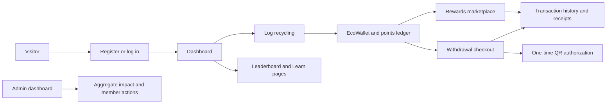
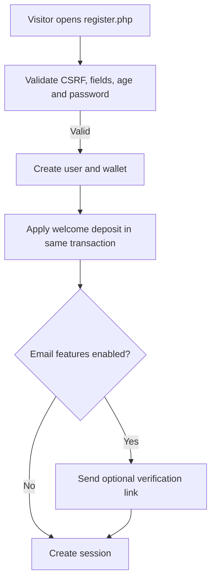
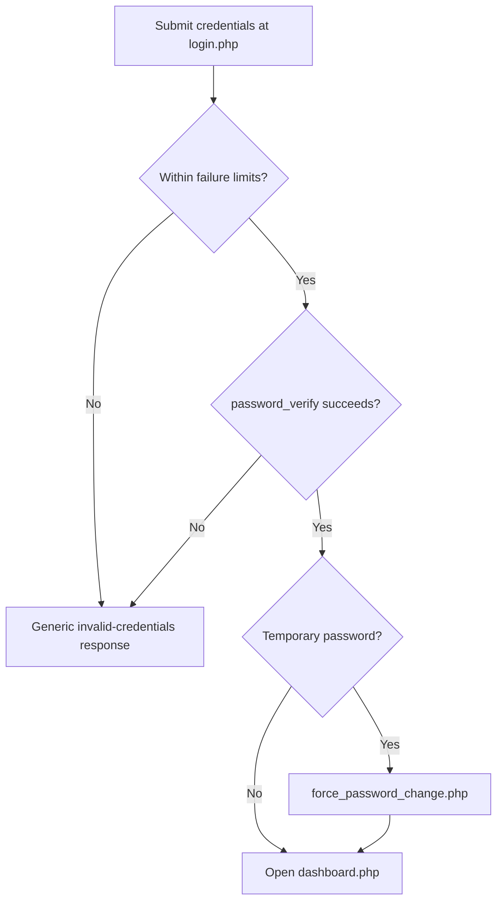
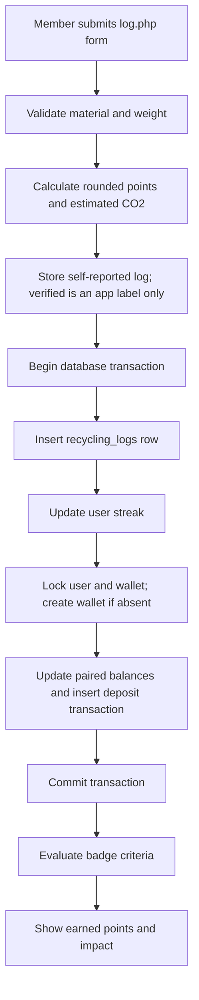
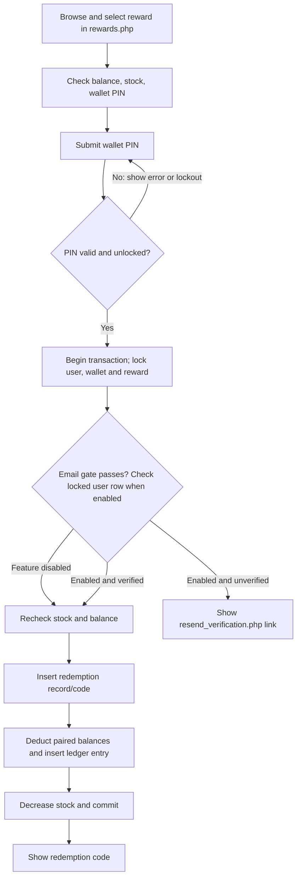
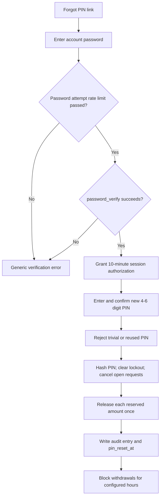
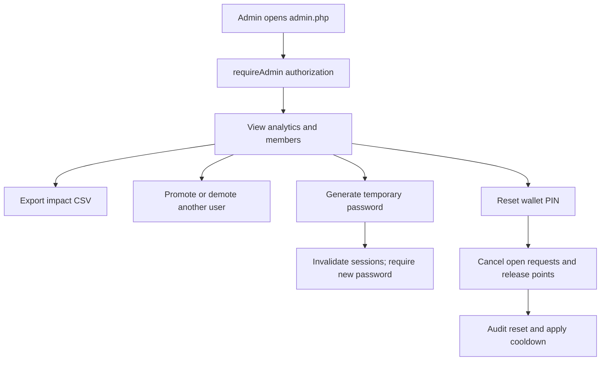
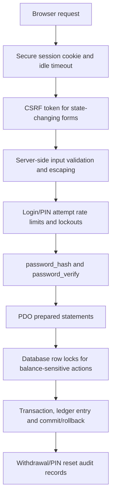

# EcoCycle Flowcharts

## Whole-system overview

## Sign-up

Email verification is implemented but disabled by default (`EMAIL_FEATURES_ENABLED=false`).

## Login, lockout, and forced password change

## Recycling log to points to wallet

## Reward redemption

## Withdrawal request lifecycle

```mermaid
stateDiagram-v2
    [*] --> pending: Create request; deduct from balances and reserve points
    pending --> authorized: E-wallet/bank QR accepted once
    pending --> completed: Voucher confirmed with PIN
    authorized --> completed: Simulated payout finalized
    pending --> expired: Expiry sweep; release reservation once
    authorized --> expired: Expiry sweep; release reservation once
    pending --> cancelled: Member/admin cancellation; release reservation once
    authorized --> cancelled: Member/admin cancellation; release reservation once
    note right of pending
        Expiry is swept lazily when a page or operation invokes the sweep.
        Reserved points can remain held until the next sweep.
    end note
    completed --> [*]: Keep original deduction; write transaction and receipt
    expired --> [*]: Reservation returned to both balances
    cancelled --> [*]: Reservation returned to both balances
```

## PIN reset and cooldown

## Admin actions

## Security layers

## Verified against

- `register.php`
- `login.php`
- `force_password_change.php`
- `log.php`
- `rewards.php`
- `withdrawal_checkout.php`
- `withdrawal_authorize.php`
- `pin_reset.php`
- `resend_verification.php`
- `admin.php`
- `includes/functions.php`
- `config/config.php`
- `sql/schema.sql`

## Not sure about

- The deployment's mail adapter, database server version/settings, and production security headers may vary from local configuration.
- Real payout settlement is not shown in source; the diagrams represent the simulated withdrawal lifecycle only.
- Actual email delivery depends on deployment-specific mail configuration and was not tested. Email verification itself is implemented, disabled by default, and enforced during redemption when enabled.
- The exact delay between request expiry and the next page/operation that invokes the lazy sweep depends on when that sweep is next invoked.
