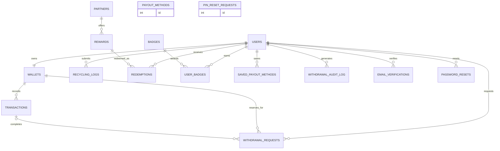

# EcoCycle System Overview

## Purpose

EcoCycle is a recycling rewards community website intended to encourage responsible consumption and production in line with UN Sustainable Development Goal 12. Members record recycling activity, see estimated points and environmental impact, and can spend points on listed rewards or simulated wallet payouts. Recycling logs are self-reported: the application has no collection-center verification, independent weighing, or fraud review. The `verified` value used by the application is a database label/default, not an independent check.

## User roles

| Role | Capabilities |
|---|---|
| Visitor | Browse the landing page, recycling education pages, leaderboard, and rewards catalogue; register or sign in. Actions requiring an account redirect to sign-in. |
| Member | Log recycling, view personal dashboard/profile/badges, redeem rewards with wallet PIN, manage EcoWallet/PIN, request a simulated withdrawal, inspect transactions/receipts and export wallet transactions. |
| Admin | Use `admin.php` for community analytics and CSV impact export; promote or demote other users; generate a temporary password for a member; clear a member's wallet PIN and cancel open withdrawal requests. An admin cannot change their own admin role. Admins also have ordinary member functionality. |

## Pages and modules

| Area | Files | Purpose |
|---|---|---|
| Public entry and navigation | `index.php`, `includes/header.php`, `includes/footer.php` | Mission/impact landing page, site-wide navigation, shared layout and theme. |
| Accounts | `register.php`, `login.php`, `logout.php`, `force_password_change.php`, `forgot_password.php`, `reset_password.php`, `verify_email.php`, `resend_verification.php` | Registration, login/session lifecycle, password changes and optional email-based actions. Email verification is implemented but disabled by default. |
| Member activity | `log.php`, `dashboard.php`, `profile.php`, `leaderboard.php`, `learn.php` | Recycling entry and history, individual impact, account settings/badges/redemptions, community rankings, sorting advice. |
| Rewards | `rewards.php` | Reward catalogue and PIN-confirmed redemption. |
| Wallet and payouts | `wallet.php`, `withdrawal_checkout.php`, `withdrawal_authorize.php`, `pin_reset.php`, `receipt.php` | Wallet/PIN actions, three-step withdrawal checkout, one-time QR authorization, transaction receipts and CSV export. |
| Administration | `admin.php` | Admin analytics, member role/password/PIN actions, impact CSV. |
| Shared application logic | `includes/functions.php`, `config/config.php` | Database/session/security helpers, point accounting, wallet and withdrawal lifecycle, validation and settings. |
| Schema and setup | `sql/schema.sql`, `setup.php`, `setup_wallet.php`, `migrate_*.php` | Fresh-install schema/seed data and incremental database changes. Setup scripts are not normal user-facing application pages. |
| Desktop wrapper and QR | `electron/main.js`, `electron/preload.js`, `assets/js/withdrawal-qr.js`, `assets/js/withdrawal-qr.bundle.js` | Electron window loads the local web app; browser QR rendering uses the `qrcode` package bundled with Browserify. |

## Technology

- Server-rendered PHP application using PDO with MySQL/MariaDB; the repository documents local XAMPP setup in `setup.php`.
- The shared PDO connection enables exception mode, associative fetches, native prepared statements, and sets the MySQL session time zone to the current PHP UTC offset. PHP's configured application time zone is `Asia/Manila`.
- HTML, CSS, and browser JavaScript provide the interface. Tailwind is compiled to `assets/css/tailwind.css`; Chart.js, Nunito, and the QR library are served from local files under `assets/`. Application-specific styles are in `assets/css/style.css`. Normal application page use does not require internet access.
- The optional Electron desktop shell uses Electron `BrowserWindow` and loads the local EcoCycle URL. Its preload file does not expose APIs to the renderer; the window enables context isolation and disables Node integration.
- `qrcode` (through Browserify) generates the checkout QR code locally in the browser. It contains a one-time authorization URL; it does not represent a connection to a real payout provider.
- Payouts are simulated. The withdrawal UI and transaction ledger explicitly say that no real money moves.
- Email verification is implemented but `EMAIL_FEATURES_ENABLED` defaults to `false` in `config/config.php`. When enabled, `register.php`, `verify_email.php`, and `resend_verification.php` implement verification; reward redemption requires verified email and rechecks `email_verified_at` on the locked user row inside the redemption transaction in `rewards.php`. Email uses the configured mail adapter (`log` or PHPMailer SMTP). Environment-specific values belong in ignored secrets/configuration and are intentionally not reproduced here.

## Database tables

| Table | Purpose |
|---|---|
| `users` | Member identity, password hash, profile, role, session version, point balances, lifetime point total, and recycling streak. |
| `admin_password_reset_logs` | Records which administrator reset which member password. |
| `login_attempts` | Stores hashed account/action identifiers, IP address, success flag, and timestamp for rate limiting. |
| `email_verifications` | Hashes and lifecycle timestamps for optional single-use email verification links. |
| `password_resets` | Hashes and lifecycle timestamps for optional single-use password reset links. |
| `neighborhoods` | Active neighborhood reference names; the user profile stores a neighborhood string rather than a foreign key. |
| `wallets` | One EcoWallet per user: current and lifetime balances, PIN hash, lockout counters and PIN-reset timestamp. |
| `transactions` | Wallet ledger entries for deposits, withdrawals, redemptions, and adjustments, including reference, balance-after, and receipt JSON. |
| `payout_methods` | In the schema but unused by current flows. The current checkout's saved-method flow uses `saved_payout_methods`. |
| `pin_reset_requests` | In the schema but unused by current flows. `pin_reset.php` verifies the account password and does not use this OTP-style table. |
| `saved_payout_methods` | Current checkout's saved bank/e-wallet labels, provider, last four digits, and a password hash of the account destination. |
| `withdrawal_audit_log` | Withdrawal and wallet-security audit events, including action metadata and optional JSON details. |
| `withdrawal_requests` | Withdrawal checkout state, reserved points, payout metadata, expiry, single-use authorization fields, and linked completed transaction. |
| `recycling_logs` | Self-reported material, quantity, weight, awarded points, estimated CO₂ savings, note, timestamp, and an app-level verification status label. No collection-center verification, independent weighing, or fraud review is performed. |
| `partners` | Business/cause names and categories for marketplace rewards. |
| `rewards` | Partner-linked reward listings, cost, stock, category, and optional expiry date. |
| `redemptions` | Issued reward codes, member/reward link, points spent, and redemption status. |
| `badges` | Badge catalogue and achievement criteria identifiers. |
| `user_badges` | Join records recording which badges a user has earned and when. |

### Main foreign-key relationships

The diagram's connected relationships follow declared foreign keys in `sql/schema.sql`; the two disconnected tables shown are in the schema but unused by current flows. `neighborhoods` is a reference list but `users.neighborhood` is a string without a declared foreign key. `login_attempts` associates attempts through a hashed identifier rather than a user ID. `admin_password_reset_logs` contains administrator and target IDs but declares no foreign keys.

## Key business rules

| Rule | Current value/behavior | Source |
|---|---|---|
| Points per kilogram | Plastic 10; glass 6; paper 5; metal 12; e-waste 15; organic 4. Award is rounded from `weight_kg × points_per_kg`. | `includes/functions.php` (`materials()`, `recordRecyclingLog()`) |
| Recycling entry weight | Greater than 0 and no more than 100 kg per entry. | `config/config.php` (`RECYCLING_MAX_KG_PER_ENTRY`), `log.php`, `includes/functions.php` (`recordRecyclingLog()`) |
| Daily recycling points cap | A member may earn up to 3,000 points from recycling logs per Asia/Manila calendar day. The check sums that day's log awards and runs transactionally before inserting the new log. | `config/config.php` (`RECYCLING_DAILY_POINT_CAP`), `includes/functions.php` (`recordRecyclingLog()`) |
| Welcome bonus | 20 points, applied during registration and recorded as a deposit. | `register.php`, `includes/functions.php` (`applyWelcomeBonus()`) |
| Points-to-peso conversion | 10 points per peso; checkout calculates gross amount as points divided by this setting. | `config/config.php` (`WALLET_POINTS_PER_PESO`), `includes/functions.php` |
| Minimum withdrawal | 500 points. | `config/config.php` (`WALLET_MIN_WITHDRAWAL`) |
| Daily withdrawal cap | 5,000 points. | `config/config.php` (`WALLET_DAILY_WITHDRAWAL_CAP`) |
| Daily reset boundary | `CURDATE()` in MySQL. The PDO session time zone is set to PHP's UTC offset; PHP is configured to `Asia/Manila`, so the intended database day boundary is Manila midnight. | `config/config.php`, `includes/functions.php` (`getDailyWithdrawalTotal()`, `db()`) |
| QR/checkout expiry | 10 minutes from request creation; request expiration is calculated in MySQL from `CURRENT_TIMESTAMP`. Countdown seconds are computed by MySQL and then decremented/polled in the browser. | `config/config.php` (`WALLET_WITHDRAWAL_EXPIRY_MINUTES`), `includes/functions.php`, `withdrawal_checkout.php` |
| Withdrawal expiry sweep | Lazy: expired requests are swept when application pages/operations that invoke the sweep run. Reserved points can remain held after expiry until the next such sweep. | `wallet.php`, `withdrawal_checkout.php`, `includes/functions.php` (`sweepExpiredWithdrawalRequests()`) |
| Email verification | Implemented but disabled by default (`EMAIL_FEATURES_ENABLED=false`). When enabled, redemption requires a verified address; the gate is checked on the locked user row inside the redemption transaction. | `config/config.php`, `register.php`, `verify_email.php`, `resend_verification.php`, `rewards.php` |
| PIN format | Initial wallet PIN: 4–6 digits. Reset PIN additionally rejects repeated digits and simple forward/backward sequences, and disallows reusing the current PIN. | `wallet.php`, `pin_reset.php`, `includes/functions.php` |
| PIN lockout | Three failed attempts trigger a 15-minute lockout; successful verification clears the counter and lock. | `includes/functions.php` (`verifyPin()`) |
| PIN-reset cooldown | 24 hours by default, configurable with `PIN_RESET_COOLDOWN_HOURS`; applies after member or admin PIN reset. | `config/config.php`, `includes/functions.php` |
| Account password | 8–64 characters with uppercase, lowercase, and digit; a configured common-password list is rejected; a Have I Been Pwned range check is attempted. If that external check is unavailable, the password is allowed and the failure is logged. | `config/config.php` (`passwordPolicyError()`, `passwordHasBeenPwned()`) |
| Account age | At least 13 years old. Server-side registration compares the birthdate to the current date in UTC. | `register.php` |
| Login rate limit | Within a rolling 15-minute window, a fifth recorded failed attempt for an identifier causes subsequent attempts to be blocked; a twentieth recorded failure from an IP causes subsequent attempts from that IP to be blocked. Successful attempts do not count as failures. | `includes/functions.php` (`loginIsRateLimited()`), `login.php` |
| Session idle timeout | Session is logged out after more than 30 minutes of inactivity. | `includes/functions.php` |

## Verified against

- `config/config.php`
- `includes/functions.php`
- `sql/schema.sql`
- `setup.php`
- `index.php`
- `register.php`
- `wallet.php`
- `withdrawal_checkout.php`
- `withdrawal_authorize.php`
- `pin_reset.php`
- `rewards.php`
- `resend_verification.php`
- `admin.php`
- `package.json`
- `electron/main.js`
- `electron/preload.js`
- `assets/js/withdrawal-qr.js`
- `assets/css/style.css`

## Not sure about

- Production hosting, production database configuration, and whether deployment values differ from the local defaults are not inferable from the source tree.
- Whether a production mail server is configured or delivery succeeds depends on private runtime configuration and was not tested.
- External payout fulfillment is not implemented in the reviewed code; checkout records simulated withdrawals only.
- The intended future role, if any, of the schema tables `pin_reset_requests` and `payout_methods` is not stated.
- The exact time between a request's expiry and the next page/operation that runs the lazy expiry sweep depends on when that sweep is next invoked.
